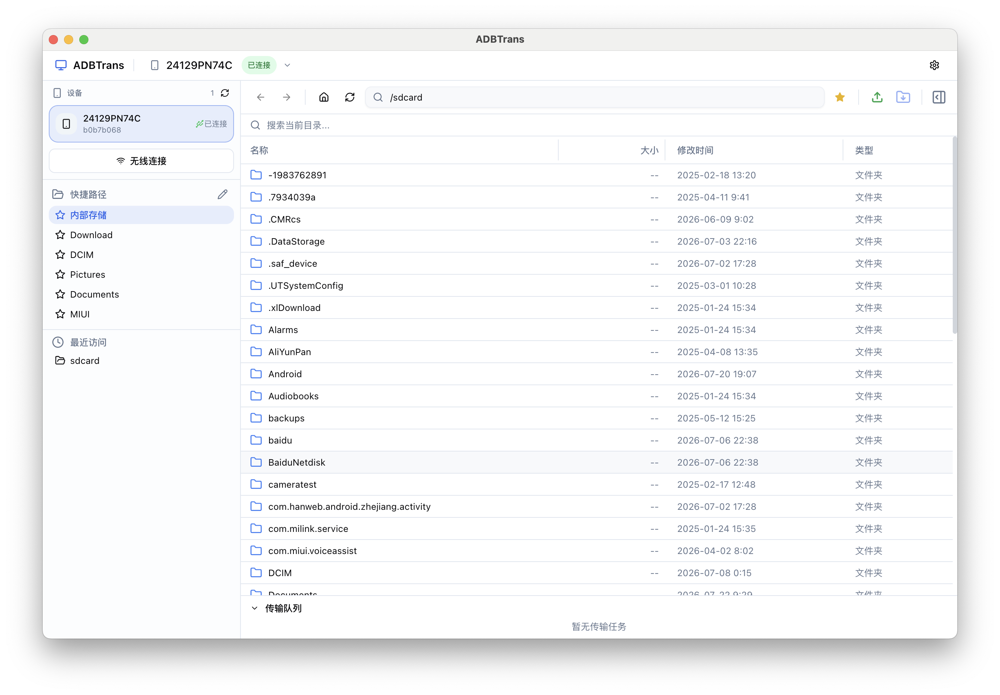

# ADBTrans

[中文](./README.md) | English

A cross-platform desktop file manager built on ADB, providing two-way file transfer and on-device file browsing between your computer and Android phone.

Current version: **v1.8.0**

## Features

### Device Management
- **ADB detection** — Checks for ADB on startup and guides you through installation if missing
- **Automatic discovery** — Tracks Android devices connected over USB or Wi-Fi in real time
- **Device list** — Switch devices from the top dropdown, with connection state and model
- **Storage and memory status** — Shows free ROM space and RAM usage on the device card, refreshed every 10 seconds
- **Wireless connection** — Connect over `adb connect` with an IP:Port address

### File Browsing
- **Path navigation** — Jump to a path by typing it, with back/forward/home
- **Directory listing** — Shows name, size, modified time, type, and permissions
- **Sorting** — Click a column header to sort by name, size, modified time, or type; click again to reverse. Folders always come first
- **Column resizing** — Drag column edges to resize
- **File search** — Instant filtering in the current folder, plus a whole-device filename search from `/` (skips /proc, /sys, and /dev)
- **Search result navigation** — Open a folder or jump to a file's containing folder; distinguishes empty results, timeouts, and disconnected devices
- **Multi-select** — Long-press or Shift+click to select multiple files
- **Path history** — Records visited paths with back/forward navigation

### Quick Paths and Bookmarks
- **Quick paths** — Preset folders in the sidebar (Internal Storage, Download, DCIM, etc.)
- **Bookmarks** — Bookmark the current path from the toolbar with a custom name
- **Bookmark management** — Add, edit, or delete quick paths from the gear dialog
- **Persistence** — Bookmarks are stored in localStorage and survive restarts

### File Transfer
- **Two-way transfer** — Phone → Computer / Computer → Phone
- **Folder transfer** — Recursively download an entire folder
- **Transfer progress** — Live progress bar and speed
- **Transfer queue** — Multiple queued transfers with cancellation; the latest task stays on top
- **Drag and drop upload** — Drag files from your computer onto the file list or sidebar to upload them
- **Copy/move on the phone** — Right-click selected files or folders and choose "Copy to..." or "Move to...". Cross-partition moves automatically fall back to copy + delete, with overwrite confirmation for same-name files
- **Destination folder picker** — Browse the `/sdcard` directory tree level by level to pick a destination, with shortcuts for Internal Storage, Download, DCIM, and more, or type any absolute path manually

### File Preview
- **Image preview** — Supports jpg/png/gif/webp/bmp with instant preview
- **Image format validation** — Detects the real image format from file headers; files with an image extension but invalid content fall back to a normal icon, avoiding broken images and layout glitches
- **Image thumbnails** — 32x32 thumbnails in the file list
- **Text preview** — Supports txt/log/md/json/xml/html/css/js/ts/py and more; unknown extensions can choose and remember a default preview mode
- **Raw image preview** — Supports NV21 (YUV) files with per-extension saved dimensions
- **File details** — Name, path, size, modified time, permissions, and more
- **Smart layout** — Images: preview and details combined; text: preview/details tabs; other files: details only

### File Search
- **Multi-keyword search** — Both folder and whole-device searches accept multiple keywords separated by `;` or `；`, matching any keyword

### ADB Scripts
- **Script workspace** — Create, edit, import, delete, and run ADB host scripts
- **Platform support** — Windows supports bat/cmd, macOS supports sh/command; incompatible scripts cannot run
- **Device environment** — Automatically provides the current device serial, model, and bundled ADB path as environment variables
- **Live output** — Shows stdout, stderr, and exit code, with stop and timeout support
- **Run protection** — Imported scripts require confirmation before their first run

### App and Updates
- **Version info** — Current version and platform under "Settings → About & Updates"
- **Update checks** — Checks GitHub Releases for stable versions and matches macOS/Windows and CPU architecture
- **Automatic reminders** — Checks on startup and every 6 hours; a red dot appears on the bottom-left sidebar icon when an update is available
- **Update throttling** — Reuses local caches and ETag conditional requests to reduce GitHub API calls; quota or network failures show a clear reason and retry time without repeated prompts
- **Safe download** — Opens the matching installer or GitHub Release page directly

### Interface Language
- **Chinese/English switching** — Switch between 中文 and English in Settings; the choice is saved and applied automatically to buttons, hints, dialogs, menus, and error messages

### Logs
- **Logging** — Key output from the main process, ADB transfers, and scripts is written to log files for troubleshooting
- **Size limits** — Rotates at 20MB per file with one backup (40MB total); oversized entries are truncated
- **Log management** — "Settings → Logs" shows the current size and lets you open the log folder or clear logs after confirmation
- **Crash capture** — Uncaught exceptions and unhandled Promise rejections are written to the log

## Tech Stack

| Layer | Technology |
|-------|------------|
| Desktop framework | Electron 33 |
| Frontend | React 18 + TypeScript |
| Build tooling | Vite + electron-vite |
| Styling | TailwindCSS 3 |
| UI components | shadcn/ui (Radix UI) |
| State management | Zustand |
| ADB communication | Node.js child_process |

## Requirements

- **Node.js** >= 18
- **ADB** — Bundled under `resources/adb/`; no separate installation needed
- **Android phone** — USB debugging enabled

## Quick Start

```bash
# Install dependencies
npm install

# Start in development mode
npm run dev

# Type checking
npm run typecheck
```

## Packaging

```bash
# Build macOS (Apple Silicon + Intel)
npm run dist:mac

# Build Windows x64
npm run dist:win

# Build all platforms (bundled mac + win adb, about 123MB)
npm run dist
```

Artifacts are written to `release/`:
- macOS Apple Silicon: `ADBTrans-{version}-mac-arm64.dmg`
- macOS Intel: `ADBTrans-{version}-mac-x64.dmg`
- Windows x64: `ADBTrans-{version}-win-x64.exe`

GitHub update checks require stable releases to use a `v{version}` tag (for example `v1.0.10`) and to upload all platform installers to the same release.


## Project Structure

```
ADBTrans/
├── src/
│   ├── main/                 # Electron main process
│   │   ├── index.ts          # Window creation, IPC registration
│   │   ├── adb.ts            # ADB command wrappers (ls/pull/push/cat, etc.)
│   │   ├── scriptService.ts  # Script storage, import, and execution
│   │   ├── update.ts         # GitHub Release checks, cache, and throttling
│   │   └── logger.ts         # Logs (console capture, 20MB rotation)
│   ├── preload/              # Preload scripts
│   │   ├── index.ts          # API bridge (contextBridge)
│   │   └── index.d.ts        # Type declarations
│   └── renderer/             # React frontend
│       └── src/
│           ├── App.tsx        # Root component and layout
│           ├── main.tsx       # Entry point
│           ├── globals.css    # Global styles
│           ├── i18n/          # Chinese/English copy and auto translation
│           ├── lib/utils.ts   # Utilities
│           ├── stores/        # Zustand stores
│           │   ├── deviceStore.ts    # Device connection state
│           │   ├── fileStore.ts      # File list, selection, history
│           │   ├── queueStore.ts     # Transfer queue
│           │   └── bookmarkStore.ts  # Quick path bookmarks
│           └── components/
│               ├── layout/          # Layout components
│               │   ├── Sidebar.tsx         # Sidebar (devices, quick paths, settings)
│               │   └── Toolbar.tsx         # Toolbar (navigation, upload/download, bookmarks)
│               ├── device/          # Device components
│               │   ├── DeviceCard.tsx      # Device card
│               │   ├── AdbWarning.tsx      # ADB not installed warning
│               │   └── WirelessConnectDialog.tsx  # Wireless connection dialog
│               ├── file/            # File browsing
│               │   ├── FileTable.tsx       # File table (sorting, multi-select, search, resizing)
│               │   ├── SearchResults.tsx   # Whole-device search results
│               │   ├── RemotePathPickerDialog.tsx # Destination folder picker
│               │   └── Thumbnail.tsx       # Image thumbnail
│               ├── preview/         # File preview
│               │   └── PreviewPanel.tsx    # Preview panel (image/text/info)
│               ├── scripts/         # ADB script workspace
│               │   └── ScriptWorkspace.tsx # Editing, running, live output
│               ├── queue/           # Transfer queue
│               │   └── TransferQueue.tsx   # Queue panel (progress, status, actions)
│               ├── bookmark/        # Bookmark management
│               │   └── BookmarkDialog.tsx  # Bookmark dialog
│               └── ui/              # Base UI components (shadcn/ui)
├── resources/                # App icons, ADB tools, and other assets
│   ├── icon.icns            # macOS app icon
│   ├── icon.png             # Generic app icon
│   └── adb/                 # Bundled ADB tools
│       ├── mac/             # macOS build
│       └── win/             # Windows build
├── scripts/                 # Build scripts
├── electron.vite.config.ts
├── tailwind.config.js
└── package.json
```

## Interface



## Data Flow

```
User action → React UI (Zustand Store)
            → Electron IPC (window.api.invoke)
            → Main Process (ipcMain.handle)
            → ADB Service (child_process.spawn/execFile)
            → ADB Daemon (Android device)
            → Result → IPC → UI update
```

## Milestones

| Phase | Scope | Status |
|-------|-------|--------|
| M1 | Electron + React setup, ADB detection, device list | ✅ |
| M2 | Path navigation, file list rendering, adb shell ls parsing | ✅ |
| M3 | pull / push, progress display, transfer queue | ✅ |
| M4 | Image and text preview, thumbnails, file info panel | ✅ |
| M5 | Drag-and-drop transfer, file operations, wireless connection, bookmarks | ✅ |
| M6 | electron-builder setup, macOS + Windows installers | ✅ |

## License

[GPL v3](LICENSE)
